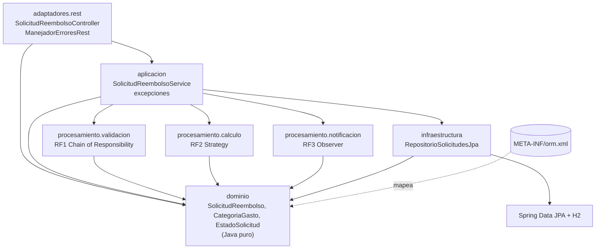
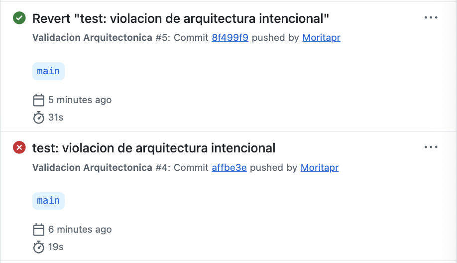
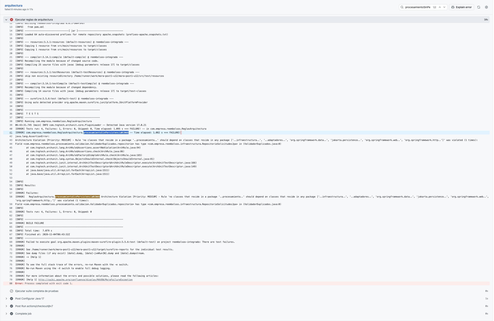
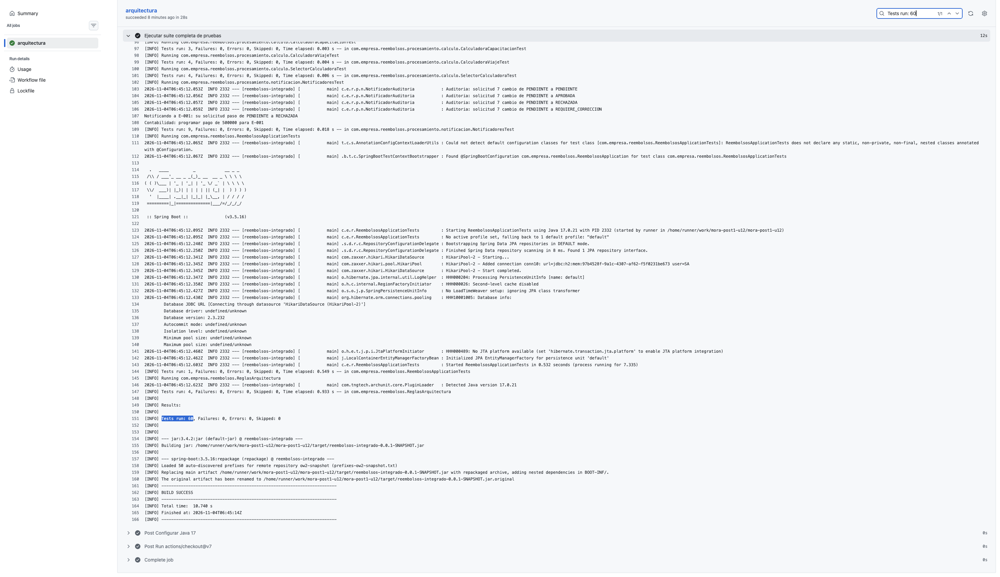

# mora-post1-u12 - Proyecto Integrador: Sistema de Solicitudes de Reembolso de Gastos Corporativos

Post-contenido U12 (Patrones de Diseño de Software, UDES). Proyecto Maven `reembolsos-integrado`
(Spring Boot 3.5.16, Java 17; dependencias: `spring-boot-starter-web`, `spring-boot-starter-data-jpa`,
`h2` en runtime y `spring-boot-starter-test`). Paquete base `com.empresa.reembolsos`.

```bash
mvn clean test      # pruebas
mvn spring-boot:run # API en http://localhost:8080/api/solicitudes
```

Todas las salidas pegadas en este documento se obtuvieron ejecutando el comando indicado.

**Contenido:** 1. Diseño Propuesto · 2. Decisiones de diseño 1 a 4 · 3. Arquitectura resultante · 4. ADR-001 (completo) · 5. Qué se descartó y por qué · 6. Evidencia del pipeline · 7. Pruebas (60) · 8. Historial de commits

---

## 1. Diseño Propuesto

Escrito **antes** de implementar cualquier patrón (commit `docs:` de línea base). Para cada requisito se
identifica qué varía, qué patrón lo resuelve y por qué ese y no otro (test de explicabilidad: una oración).

| RF | Qué varía (punto de variabilidad) | Patrón | Justificación (una oración) |
|---|---|---|---|
| RF1 - Validación en varias etapas | El **conjunto de verificaciones** que una solicitud debe superar (hoy 3; mañana p. ej. el límite anual acumulado), cada una con su propio motivo de rechazo | **Chain of Responsibility** | Las verificaciones se aplican *todas*, en secuencia, y la primera que rechaza corta el recorrido con su motivo, así que modelar cada una como un eslabón que solo conoce al siguiente permite agregar el límite anual como un eslabón nuevo sin modificar ni conocer los tres existentes. |
| RF2 - Cálculo distinto por categoría | La **fórmula del monto aprobado**, que depende de la categoría (tope diario x días, monto completo hasta tope mensual, 80 % hasta tope anual; mañana "bienestar") | **Strategy** | Para cada solicitud se aplica exactamente *una* fórmula entre varias intercambiables, elegida en tiempo de ejecución por la categoría, de modo que "bienestar" será una clase nueva que implementa `CalculadoraReembolso` sin tocar las fórmulas de viaje, representación ni capacitación. |
| RF3 - Notificación simultánea | El **número de interesados** en un cambio de estado y la **reacción** de cada uno (empleado: todo; Contabilidad: solo APROBADA; auditoría: todo; mañana el panel de métricas) | **Observer** | Un mismo evento (la solicitud cambió de estado) debe llegar a *todos* los interesados, cada uno con su propio filtro y reacción, sin que el servicio que cambia el estado sepa quiénes son, así que el panel de métricas será un observador más registrado sin tocar el servicio. |

**Por qué son tres problemas distintos (y no el mismo patrón repetido).** Los tres requisitos "tienen
varias implementaciones", pero la relación entre ellas es diferente en cada uno:

| | Cuántas implementaciones actúan por solicitud | ¿Puede una cortar a las demás? | ¿Devuelven resultado? |
|---|---|---|---|
| RF1 (Chain) | Todas, en orden, hasta el primer rechazo | Sí: el rechazo detiene la cadena | Sí: válida / motivo |
| RF2 (Strategy) | Exactamente una, según la categoría | No aplica: solo se ejecuta una | Sí: monto aprobado |
| RF3 (Observer) | Todas, sin orden de negocio | No: todas deben enterarse | No: solo reaccionan |

> *Nota posterior a la implementación (commit `d20af39`):* el orden sí terminó importando, no por una regla de negocio entre observadores, sino por la garantía de RF3 de que auditoría registre todo cambio "sin excepción". `forEach` se detiene en la primera excepción, así que se fijó Auditoría -> Empleado -> Contabilidad con `@Order` (ver la sección 3 y el ADR-001). El texto de arriba se conserva tal como se escribió antes del código.

**Alternativas consideradas y por qué no:**

- RF1 con Strategy (elegir *una* validación) no cumple el requisito: no se elige una, se exigen las tres.
  RF1 con una simple `List<Validador>` recorrida por el servicio funcionaría, pero dejaría en el servicio
  la política de corte y el orden; la cadena encapsula ambos en `CadenaValidadores`.
- RF2 con un `switch` sobre `CategoriaGasto` o con métodos abstractos en el enum concentra todas las
  fórmulas (y sus topes) en un mismo lugar que hay que **modificar** por cada categoría nueva, justo lo que
  RF2 prohíbe; además llevaría reglas de Finanzas al paquete `dominio`.
- RF3 con llamadas directas desde el servicio a los tres notificadores acopla el servicio a cada interesado
  y obliga a editarlo para el panel de métricas.
- La selección de la estrategia (`SelectorCalculadora`) es un mapa categoría -> calculadora construido con
  los beans que inyecta Spring; no se introduce una Factory aparte porque no hay lógica de creación que
  encapsular (las calculadoras no tienen estado).

---

## 2. Decisiones de diseño

### Decisión de diseño 1 - Orden de la cadena de validadores

**Elegido: documentos -> monto -> duplicados** (de la verificación más barata a la más cara).

| Eslabón | Coste por solicitud |
|---|---|
| `ValidadorDocumentosSoporte` | O(1): lee un `boolean` |
| `ValidadorMontoMaximo` | O(1): búsqueda en un `Map` de 3 entradas y un `compareTo` |
| `ValidadorDuplicados` | O(n): recorre las pendientes del empleado y construye un `YearMonth` por cada una |

- **Con duplicados al final (elegido)** se gana que toda solicitud rechazada por documentos o por monto
  no recorre la lista, y que el empleado recibe primero el motivo más fácil de corregir (adjuntar
  soportes, ajustar el monto). Se pierde que una solicitud duplicada ejecuta antes dos verificaciones
  O(1) inútiles, un coste constante y despreciable.
- **Con duplicados primero** se ganaría cortar antes solo si los duplicados fueran el rechazo más
  frecuente (no hay datos que lo indiquen); se pierde que *todas* las solicitudes, incluidas las que
  fallarían por un `boolean`, pagan el recorrido, y que una solicitud sin soportes y duplicada se
  rechazaría como "duplicada" aunque, aun quitando la otra, seguiría siendo inválida.

Matiz honesto: en este diseño la consulta a la base (`findByEmpleadoIdAndEstado`) la hace el servicio
**antes** de invocar la cadena, así que el orden ahorra el recorrido en memoria, no la consulta. Pasar
un proveedor perezoso (`Supplier<List<...>>`) para ahorrarla también se descartó: la propia regla de
duplicados limita la lista a una pendiente por empleado, categoría y mes, de modo que es corta, y
cambiar la firma de todos los eslabones por esa ganancia no supera el test de explicabilidad. El orden
queda fijado por `CadenaValidadoresTest` (con varios incumplimientos gana el primer eslabón).

### Decisión de diseño 2 - Selección de la calculadora: mapa desde `List<CalculadoraReembolso>` vs. `switch`

**Elegido: el mapa** que `SelectorCalculadora` construye con la lista de `@Component` que inyecta Spring.

RF2 exige agregar categorías "sin modificar el cálculo de las categorías existentes". Para agregar
"bienestar":

| | Mapa desde la lista (elegido) | `switch` manual sobre `CategoriaGasto` |
|---|---|---|
| Código nuevo | `CalculadoraBienestar` + la constante `BIENESTAR` en el enum | Igual |
| Código existente **modificado** | Ninguna línea: `SelectorCalculadora` y las 3 calculadoras quedan intactas | El método del `switch` (un `case` más) cada vez |
| Acoplamiento | El selector solo conoce la interfaz | El selector importa cada calculadora concreta |
| Categoría sin calculadora | Detectada al arrancar (ver abajo) | Detectada al compilar si el `switch` es una expresión exhaustiva |

Solo el mapa cumple RF2 sin tocar una línea ya escrita (la constante del enum es una línea agregada,
inevitable en ambas opciones, porque la categoría es un dato del dominio). Lo que el `switch` hacía mejor
era detectar una categoría olvidada; para no perderlo, `SelectorCalculadora` comprueba al construirse
que cada valor de `CategoriaGasto` tenga calculadora y que no haya dos para la misma, y si no, el
contexto no arranca (`IllegalStateException`, probado en `SelectorCalculadoraTest`). Alternativa
descartada: el `switch`, porque obliga a editar el selector en cada semestre que Finanzas agregue una
categoría, que es exactamente el cambio que RF2 anticipa.

### Decisión de diseño 3 - Capas simples vs. Hexagonal

Resumen: para la **persistencia** se mantienen capas simples, porque no se cumple el criterio de la Guía 6.2
(no hay ningún plan de cambiar el motor y el repositorio tiene un solo consumidor que usa 3 métodos). Para
la **notificación**, que sí tiene un cambio de infraestructura con fecha (la API de Contabilidad el próximo
trimestre), no se agrega ningún puerto, porque `ObservadorCambioEstado` ya es el seam. El aislamiento de
fallos por observador queda como señal futura atada a esa integración. Desarrollo completo en la sección 4
(ADR-001).

### Decisión de diseño 4 - Por qué la Regla 1 distingue los estereotipos de Spring del acceso a datos y web

La Regla 1 prohíbe en `procesamiento` las dependencias de persistencia (`org.springframework.data`,
`jakarta.persistence`, `infraestructura`) y de web (`adaptadores`, `org.springframework.web/http`),
pero no todo `org.springframework`. El criterio es si la dependencia cambia **cómo se comporta o cómo se
prueba** la lógica, o solo **cómo se registra**:

- **Estereotipos (aceptables).** Los únicos imports de Spring en `procesamiento` son
  `org.springframework.stereotype.Component` (11 clases) y `org.springframework.core.annotation.Order`
  (3 observadores). Son metadatos de registro y orden: no cambian ninguna línea de lógica, y las 9 clases
  de prueba unitaria de `procesamiento` instancian validadores, calculadoras y notificadores con `new`,
  sin contexto de Spring. Prohibirlos obligaría a declarar los 11 beans a mano en una clase
  `@Configuration`, y además a mano el orden de la cadena y de los observadores, que hoy está en
  `CadenaValidadores` y en `@Order`. Sería más código y más puntos de cambio sin desacoplar nada.
- **Acceso a datos y web (no aceptables).** Cambian el comportamiento y la forma de probar. Si
  `ValidadorDuplicados` consultara `RepositorioSolicitudesJpa`, la cadena haría consultas por su cuenta,
  sus pruebas necesitarían una base de datos y se perdería la decisión de que el servicio entregue las
  pendientes ya cargadas. Un cliente HTTP en un notificador haría que una prueba unitaria dependiera de la
  red.

Prohibir todo `org.springframework` sería una regla más simple de escribir, pero castigaría lo inocuo
(anotaciones) igual que lo dañino (dependencias de infraestructura). Una regla que obliga a escribir
excepciones o código de configuración por algo inofensivo acaba desactivándose.

---

## 3. Arquitectura resultante

Diagrama de paquetes y dependencias, derivado de los `import` reales de `src/main` (una flecha significa
"depende de"). Las dependencias que no aparecen están prohibidas y las verifican las reglas ArchUnit; por
ejemplo, `procesamiento` no apunta a `infraestructura` ni a `adaptadores`, y `adaptadores.rest` no apunta
a `infraestructura`.



Dependencias externas por paquete (`grep` de imports en `src/main`):

| Paquete | Depende de |
|---|---|
| `adaptadores.rest` | `aplicacion`, `dominio`, `org.springframework.web`, `org.springframework.http` |
| `aplicacion` | `dominio`, `procesamiento.*`, `infraestructura`, `org.springframework.stereotype` |
| `procesamiento.validacion` / `calculo` | `dominio`, `org.springframework.stereotype` |
| `procesamiento.notificacion` | `dominio`, `org.springframework.stereotype`, `org.springframework.core` (`@Order`), `org.slf4j` |
| `infraestructura` | `dominio`, `org.springframework.data` |
| `dominio` | solo `java.*` |

El flujo de `POST /api/solicitudes` es: controlador -> servicio -> se cargan las pendientes del empleado
(repositorio) -> `CadenaValidadores` -> `SelectorCalculadora` -> `save`. El de
`PUT /api/solicitudes/{id}/estado` es: controlador -> servicio -> `findById` -> `save` -> observadores en
orden Auditoría -> Empleado -> Contabilidad. El servicio es el único punto que conoce a la vez los tres
patrones y la persistencia.

### Estructura de paquetes y límites

```
src/main/java/com/empresa/reembolsos/
├── ReembolsosApplication.java
├── dominio/            SolicitudReembolso, CategoriaGasto, EstadoSolicitud (Java puro)
├── procesamiento/
│   ├── validacion/     RF1 - Chain of Responsibility
│   ├── calculo/        RF2 - Strategy
│   └── notificacion/   RF3 - Observer
├── aplicacion/         SolicitudReembolsoService (único que coordina los 3 patrones y el repositorio)
├── infraestructura/    RepositorioSolicitudesJpa (Spring Data JPA)
└── adaptadores/rest/   SolicitudReembolsoController (solo habla con aplicacion y dominio)
```

### Implementación de los patrones

| RF | Patrón | Clases (`procesamiento/...`) | Punto de extensión |
|---|---|---|---|
| RF1 | Chain of Responsibility | `validacion/ValidadorSolicitud` (eslabón base), `ValidadorDocumentosSoporte`, `ValidadorMontoMaximo`, `ValidadorDuplicados`, `CadenaValidadores`, `ResultadoValidacion` | Nueva subclase de `ValidadorSolicitud` + enlazarla en `CadenaValidadores` (los eslabones existentes no cambian) |
| RF2 | Strategy | `calculo/CalculadoraReembolso` (estrategia), `CalculadoraViaje`, `CalculadoraRepresentacion`, `CalculadoraCapacitacion`, `SelectorCalculadora` | Nueva clase `@Component` que implementa `CalculadoraReembolso` |
| RF3 | Observer | `notificacion/ObservadorCambioEstado` (observador), `NotificadorAuditoria` (`@Order(1)`), `NotificadorEmpleado` (`@Order(2)`), `NotificadorContabilidad` (`@Order(3)`) | Nueva clase `@Component` que implementa `ObservadorCambioEstado` y declara su `@Order` |

`aplicacion/SolicitudReembolsoService` es el único que coordina los tres patrones y el único que conoce
`infraestructura/RepositorioSolicitudesJpa`. `adaptadores/rest/SolicitudReembolsoController` solo habla
con el servicio; `adaptadores/rest/ManejadorErroresRest` (`@RestControllerAdvice`) traduce las
excepciones de aplicación a HTTP.

### Modelo de dominio sin Spring ni JPA (mapeo en `orm.xml`)

El enunciado pide un dominio sin dependencias de Spring ni de JPA, pero luego persiste
`SolicitudReembolso` con `JpaRepository<SolicitudReembolso, Long>`, lo que normalmente exige `@Entity`.
**Decisión:** el mapeo se declara en XML (`src/main/resources/META-INF/orm.xml`, registrado con
`spring.jpa.mapping-resources=META-INF/orm.xml`), un mecanismo estándar de JPA. Así el dominio queda
con 0 imports de `org.springframework` y `jakarta`, y el repositorio JPA funciona igual. Se descartó
`@Entity` en el dominio porque contradiría el requisito, y una clase de entidad JPA separada con mapper
porque duplicaría los 9 campos sin ningún beneficio hoy (YAGNI). Coste aceptado: el mapeo no está junto
a la clase y un renombre de campo debe replicarse en `orm.xml`. Si se olvida, el contexto **sí arranca**:
Hibernate solo emite un aviso y mapea el campo con valores por defecto (un enum pasaría a `ORDINAL`).
Comprobado renombrando temporalmente `diasViaje` en `orm.xml`:

```
WARN ... JPAXMLOverriddenAnnotationReader : HHH000207: Property 'com.empresa.reembolsos.dominio.SolicitudReembolso.diasDeViaje' not found in class but described in <mapping-file/> (possible typo error)
```

Por eso ese aviso debe tratarse como error al revisar el log de arranque.

Verificación (Hibernate genera la tabla desde `orm.xml`, `mvn -q test -Dspring.jpa.show-sql=true`):

```
Hibernate: create table solicitud_reembolso (dias_viaje integer, documentos_soporte boolean, fecha_gasto date not null, monto_aprobado numeric(15,2), monto_solicitado numeric(15,2) not null, id bigint generated by default as identity, empleado_id varchar(255) not null, categoria enum ('CAPACITACION','REPRESENTACION','VIAJE') not null, estado enum ('APROBADA','PENDIENTE','RECHAZADA','REQUIERE_CORRECCION') not null, primary key (id))
```

Imports del dominio:

```
$ grep -rnE "^import (org\.springframework|jakarta)" src/main/java/com/empresa/reembolsos/dominio/ | wc -l
       0
$ grep -rn "^import" src/main/java/com/empresa/reembolsos/dominio/
src/main/java/com/empresa/reembolsos/dominio/SolicitudReembolso.java:3:import java.math.BigDecimal;
src/main/java/com/empresa/reembolsos/dominio/SolicitudReembolso.java:4:import java.time.LocalDate;
```

`mvn clean package` en la línea base:

```
[INFO] Tests run: 1, Failures: 0, Errors: 0, Skipped: 0
[INFO] BUILD SUCCESS
```

---

### Reglas de arquitectura (ArchUnit 1.2.1)

`src/test/java/com/empresa/reembolsos/ReglasArquitectura.java`, con
`@AnalyzeClasses(packages = "com.empresa.reembolsos", importOptions = ImportOption.DoNotIncludeTests.class)`.

| Regla | Qué verifica |
|---|---|
| `procesamientoSinPersistenciaNiWeb` | `procesamiento` no depende de `infraestructura`, `adaptadores`, `org.springframework.data`, `jakarta.persistence`, `org.springframework.web` ni `org.springframework.http` |
| `controladorSoloUsaServicio` | `adaptadores.rest` solo accede a sí mismo, a `aplicacion`, `dominio`, `org.springframework.web`, `org.springframework.http` y `java` |
| `calculadorasImplementanInterfaz` | Las clases `Calculadora*` de `procesamiento.calculo` implementan `CalculadoraReembolso` |
| `notificadoresImplementanInterfaz` | Las clases de `procesamiento.notificacion` implementan `ObservadorCambioEstado` |

**Hallazgos al ejecutar las reglas tal como vienen en el enunciado** (`mvn test -Dtest=ReglasArquitectura`):

```
[ERROR] Tests run: 4, Failures: 2, Errors: 0, Skipped: 0
```

1. **Regla 3: `SelectorCalculadora` no es una calculadora.** Vive en `procesamiento.calculo` (junto a las
   estrategias que elige) y no implementa `CalculadoraReembolso`, ni debe hacerlo:

   ```
   Architecture Violation [Priority: MEDIUM] - Rule 'classes that reside in a package '..procesamiento.calculo..' and are not interfaces should implement com.empresa.reembolsos.procesamiento.calculo.CalculadoraReembolso' was violated (1 times):
   Class <com.empresa.reembolsos.procesamiento.calculo.SelectorCalculadora> does not implement com.empresa.reembolsos.procesamiento.calculo.CalculadoraReembolso in (SelectorCalculadora.java:0)
   ```

   Solución: acotar la regla con `.and().haveSimpleNameStartingWith("Calculadora")`, sin mover ni
   ocultar el selector. La convención de nombres ya era la del proyecto (`CalculadoraViaje`,
   `CalculadoraRepresentacion`, `CalculadoraCapacitacion`), y una `CalculadoraBienestar` que olvide
   implementar la interfaz seguiría siendo detectada.
2. **Regla 2: falla sin ninguna dependencia prohibida.** Las 6 violaciones son accesos de cada clase a sí
   misma, porque la lista permitida no incluye el propio paquete `adaptadores.rest`. Fallaría incluso con
   el controlador literal del enunciado, que asigna y lee su campo `servicio`:

   ```
   Architecture Violation [Priority: MEDIUM] - Rule 'classes that reside in a package '..adaptadores.rest..' should only access classes that reside in any package ['..aplicacion..', '..dominio..', 'org.springframework.web..', 'org.springframework.http..', 'java..']' was violated (6 times):
   Constructor <com.empresa.reembolsos.adaptadores.rest.SolicitudReembolsoController.<init>(com.empresa.reembolsos.aplicacion.SolicitudReembolsoService)> sets field <com.empresa.reembolsos.adaptadores.rest.SolicitudReembolsoController.servicio> in (SolicitudReembolsoController.java:23)
   Method <com.empresa.reembolsos.adaptadores.rest.ManejadorErroresRest.cuerpoIlegible(org.springframework.http.converter.HttpMessageNotReadableException)> calls method <com.empresa.reembolsos.adaptadores.rest.ManejadorErroresRest.problema(org.springframework.http.HttpStatus, java.lang.String, java.lang.String)> in (ManejadorErroresRest.java:30)
   Method <com.empresa.reembolsos.adaptadores.rest.ManejadorErroresRest.solicitudInvalida(com.empresa.reembolsos.aplicacion.SolicitudInvalidaException)> calls method <com.empresa.reembolsos.adaptadores.rest.ManejadorErroresRest.problema(org.springframework.http.HttpStatus, java.lang.String, java.lang.String)> in (ManejadorErroresRest.java:20)
   Method <com.empresa.reembolsos.adaptadores.rest.ManejadorErroresRest.solicitudNoEncontrada(com.empresa.reembolsos.aplicacion.SolicitudNoEncontradaException)> calls method <com.empresa.reembolsos.adaptadores.rest.ManejadorErroresRest.problema(org.springframework.http.HttpStatus, java.lang.String, java.lang.String)> in (ManejadorErroresRest.java:25)
   Method <com.empresa.reembolsos.adaptadores.rest.SolicitudReembolsoController.cambiarEstado(java.lang.Long, com.empresa.reembolsos.dominio.EstadoSolicitud)> gets field <com.empresa.reembolsos.adaptadores.rest.SolicitudReembolsoController.servicio> in (SolicitudReembolsoController.java:33)
   Method <com.empresa.reembolsos.adaptadores.rest.SolicitudReembolsoController.crear(com.empresa.reembolsos.dominio.SolicitudReembolso)> gets field <com.empresa.reembolsos.adaptadores.rest.SolicitudReembolsoController.servicio> in (SolicitudReembolsoController.java:28)
   ```

   Solución: agregar `"..adaptadores.rest.."` a la lista permitida. Con eso, la regla sigue prohibiendo
   todo lo externo (infraestructura, procesamiento, Spring Data).
3. **`DoNotIncludeTests` es necesario y el prefijo no lo sustituye.** Las pruebas unitarias viven en los
   mismos paquetes que el código. Quitando la opción, las Reglas 3 y 4 fallan por
   `CalculadoraViajeTest`, `CalculadoraRepresentacionTest`, `CalculadoraCapacitacionTest` (que además
   empiezan por "Calculadora") y `NotificadoresTest`.
4. **Regla 1 endurecida.** Su nombre dice "NiWeb", pero en el enunciado solo prohíbe `..adaptadores..`:
   un `RestClient` dentro de `procesamiento` pasaría la regla. Se agregan `org.springframework.web..` y
   `org.springframework.http..`, coherente con ADR-001 (el cliente de la API de Contabilidad vivirá en
   `infraestructura`).

5. **Surefire no ejecutaba las reglas en la suite completa.** `ReglasArquitectura` no sigue los patrones
   por defecto de Surefire (`*Test`, `*Tests`, `Test*`, `*TestCase`). Solo corría con
   `-Dtest=ReglasArquitectura`: `mvn clean verify` informaba 56 pruebas y 0 ejecuciones de
   `ReglasArquitectura`. Se agrega un `<include>` explícito en `maven-surefire-plugin` y, desde
   entonces, `mvn clean verify` ejecuta 60 pruebas (56 + 4 reglas), sin renombrar la clase que pide el
   enunciado.

Resultado final:

```
$ mvn test -Dtest=ReglasArquitectura
[INFO] Tests run: 4, Failures: 0, Errors: 0, Skipped: 0
[INFO] BUILD SUCCESS
```

### Límites entre paquetes (grep de imports)

```
$ grep -n "^import" src/main/java/com/empresa/reembolsos/procesamiento/validacion/ValidadorDuplicados.java
3:import com.empresa.reembolsos.dominio.SolicitudReembolso;
4:import java.time.YearMonth;
5:import java.util.List;
6:import org.springframework.stereotype.Component;

$ grep -rlE "^import (com\.empresa\.reembolsos\.infraestructura|org\.springframework\.data|jakarta\.persistence)" src/main/java/com/empresa/reembolsos/procesamiento/ | wc -l
       0
$ grep -rnE "^import (org\.springframework|jakarta)" src/main/java/com/empresa/reembolsos/dominio/ | wc -l
       0

$ grep -rh "^import" src/main/java/com/empresa/reembolsos/adaptadores/rest/ | sort -u
import com.empresa.reembolsos.aplicacion.SolicitudInvalidaException;
import com.empresa.reembolsos.aplicacion.SolicitudNoEncontradaException;
import com.empresa.reembolsos.aplicacion.SolicitudReembolsoService;
import com.empresa.reembolsos.dominio.EstadoSolicitud;
import com.empresa.reembolsos.dominio.SolicitudReembolso;
import org.springframework.http.converter.HttpMessageNotReadableException;
import org.springframework.http.HttpStatus;
import org.springframework.http.ProblemDetail;
import org.springframework.http.ResponseEntity;
import org.springframework.web.bind.annotation.ExceptionHandler;
import org.springframework.web.bind.annotation.PathVariable;
import org.springframework.web.bind.annotation.PostMapping;
import org.springframework.web.bind.annotation.PutMapping;
import org.springframework.web.bind.annotation.RequestBody;
import org.springframework.web.bind.annotation.RequestMapping;
import org.springframework.web.bind.annotation.RestController;
import org.springframework.web.bind.annotation.RestControllerAdvice;
```

### Desviaciones respecto al código del enunciado

| Cambio | Motivo |
|---|---|
| Mapeo JPA en `META-INF/orm.xml` en vez de `@Entity` | El dominio no puede importar Spring ni JPA (ver "Modelo de dominio"). |
| `ValidadorDuplicados` compara `YearMonth` (año y mes) en vez de `getMonth()` | Con `getMonth()`, marzo de 2025 y marzo de 2026 serían el mismo periodo y se rechazaría una solicitud legítima. Prueba: `pendienteDelMismoMesDeOtroAnio_noEsDuplicado`. |
| Se crean `SolicitudInvalidaException` y `SolicitudNoEncontradaException` en `aplicacion/` | El enunciado usa la primera sin definirla; la segunda reemplaza el `IllegalArgumentException("Solicitud no encontrada")`, que llegaría al cliente como 500. |
| `ManejadorErroresRest` (`@RestControllerAdvice`) | 400 con el motivo del validador, 404 para solicitud inexistente y 400 para JSON ilegible o categoría inexistente, en formato `ProblemDetail`. Solo usa `aplicacion`, `org.springframework.web`, `org.springframework.http` y `java` (Regla 2 de la Parte 2). |
| `crear` exige `empleadoId`, `categoria`, `montoSolicitado` y `fechaGasto` | Sin ellos los validadores lanzarían `NullPointerException` (500). Es una precondición de entrada, no una regla de negocio, por eso no es un eslabón de la cadena. |
| `crear` ignora `id`, `estado` y `montoAprobado` enviados por el cliente | Un `id` en el cuerpo del POST haría que `save` sobrescribiera otra solicitud. |
| `SelectorCalculadora` valida al arrancar que toda categoría tenga calculadora | Decisión de diseño 2. |
| Orden fijo de observadores con `@Order`: Auditoría -> Empleado -> Contabilidad | Sin `@Order`, la ejecución manual mostró Auditoría -> Contabilidad -> Empleado, un orden accidental del registro de beans. Como `forEach` se detiene en la primera excepción, RF3 ("auditoría registra todo cambio, sin excepción") dependía de esa casualidad. Auditoría va primero para que ningún fallo posterior la impida, y Contabilidad al final porque es la que integrará la API externa de pagos. El aislamiento de fallos por observador **no** se implementa (ver ADR-001, Parte 2). |

---

## 4. ADR-001 (completo)

Copia íntegra de [`docs/adr/ADR-001.md`](docs/adr/ADR-001.md); solo se bajó un nivel a los encabezados para encajarlos en este documento.

### ADR-001: Capas simples para la persistencia; el Observer ya es el seam para la integración de Contabilidad

#### Estado

Aceptado - 2026-11-04

#### Contexto

El sistema de solicitudes de reembolso integra tres patrones de comportamiento: Chain of Responsibility
(RF1), Strategy (RF2) y Observer (RF3). Hay que decidir si migra a arquitectura Hexagonal completa
(puertos e interfaces intermedias para todas sus dependencias externas) o si se mantiene en capas simples.

La Guía (sección 6.2) da el criterio: la Hexagonal vale la pena "en sistemas que sobrevivirán 3 años o
más con cambios de infraestructura". El criterio tiene dos condiciones, y aquí se evalúan por separado
para cada dependencia externa, con datos de este repositorio:

| Dependencia | ¿Sobrevivirá 3 años o más? | ¿Hay un cambio de infraestructura real? | ¿Se cumple el criterio? |
|---|---|---|---|
| Persistencia (H2 + Spring Data JPA) | Probablemente sí: reemplaza la hoja de cálculo de Finanzas, un sistema de uso continuo | **No.** No hay ningún plan de cambiar de motor de base de datos | **No** |
| Notificación | Igual que arriba | **Sí, con fecha:** Contabilidad integrará una API externa de pagos el próximo trimestre | **Sí** |

Datos del código (commit `d20af39`):

- **Persistencia.** `RepositorioSolicitudesJpa` tiene un único consumidor en `src/main`,
  `SolicitudReembolsoService`, que usa tres métodos: `findByEmpleadoIdAndEstado`, `findById` y `save`
  (este último en dos llamadas). El dominio ya no depende de JPA: el mapeo vive en `META-INF/orm.xml`
  y `dominio/` tiene 0 imports de `org.springframework` y `jakarta`. Cambiar a otro motor relacional
  (PostgreSQL, por ejemplo) solo cambia dependencias y `application.properties`, no el código, porque
  JPA ya abstrae el motor.
- **Notificación.** `SolicitudReembolsoService` solo conoce la interfaz `ObservadorCambioEstado` (recibe
  una `List<ObservadorCambioEstado>`); no importa ningún notificador concreto. Los tres observadores son
  `@Component` con orden fijo, `@Order(1)` Auditoría, `@Order(2)` Empleado y `@Order(3)` Contabilidad,
  verificado por una prueba de integración.
- **Fallos en la notificación.** `cambiarEstado` guarda el nuevo estado y luego ejecuta
  `observadores.forEach(o -> o.onCambioEstado(...))`, sin `@Transactional` ni aislamiento. Si un
  observador lanza una excepción, los siguientes no se ejecutan, el estado ya quedó guardado y el
  cliente recibe un 500. Hoy los tres observadores solo escriben en consola o en el log, así que ninguno
  falla en la práctica; la llamada a la API de Contabilidad sí podrá fallar (red, tiempo de espera,
  errores del proveedor).

#### Alternativas consideradas

1. **Hexagonal completa: puertos para persistencia y para notificación.** Una interfaz
   `RepositorioSolicitudes` en `aplicacion` con un adaptador JPA en `infraestructura`, más un puerto de
   notificación propio con adaptadores. *Descartada:* el puerto de persistencia no tiene ningún caso de
   uso que lo motive (no se cumple la condición de "cambios de infraestructura"), y el de notificación
   duplicaría una interfaz que ya existe. Coste concreto: una interfaz y un adaptador que delegaría los
   tres métodos uno a uno, sin lógica propia, es decir, una abstracción especulativa (YAGNI).
2. **Puerto solo para notificación.** Introducir un `PuertoNotificacionPagos` específico para la API
   de Contabilidad. *Descartada:* `ObservadorCambioEstado` ya cumple el papel de puerto, porque el
   servicio depende solo de la interfaz y el adaptador hacia la API externa será una implementación más.
   Otro puerto encima no pasaría el test de explicabilidad: no se puede decir en una oración qué
   desacopla que la interfaz actual no desacople ya.
3. **Capas simples, con el Observer como seam (elegida).** El servicio depende directamente de
   `RepositorioSolicitudesJpa`, y la integración de Contabilidad entra como una implementación de
   `ObservadorCambioEstado`.

#### Decisión

- **Persistencia: capas simples.** `SolicitudReembolsoService` sigue dependiendo directamente de
  `RepositorioSolicitudesJpa`, sin puerto intermedio. Para este sistema, la separación que sí aporta valor
  (dominio libre de JPA) ya está conseguida con `orm.xml`.
- **Notificación: ningún cambio estructural ahora.** Cuando llegue la integración, el cliente HTTP de la
  API de pagos vivirá en `infraestructura` (la Regla 1 de ArchUnit prohíbe que `procesamiento` dependa de
  `infraestructura`). Por eso el adaptador que reemplace a `NotificadorContabilidad` será una clase de
  `infraestructura` que implemente `ObservadorCambioEstado` y conserve `@Order(3)`.
  `SolicitudReembolsoService` y los demás observadores no cambian.
- **Aislamiento de fallos por observador: no se implementa ahora (YAGNI).** No hay try/catch por
  observador, ni reintentos, ni asincronía. Hoy ningún observador puede fallar de forma realista, y el
  único riesgo que exige RF3 hoy (que un fallo de otro observador impida el registro de auditoría) ya está
  cubierto con un cambio de coste casi nulo: Auditoría se ejecuta primero (`@Order(1)`) y lo verifica una
  prueba. Diseñar ahora la política de fallos sería decidir reintentos, idempotencia y tiempos de espera
  de una API cuyo contrato todavía no se conoce.

#### Consecuencias

**Positivas**

- No se agregan interfaces, adaptadores ni mappers de persistencia sin un caso de uso que los justifique.
  El servicio sigue mostrando de forma directa qué consulta y qué guarda.
- El único cambio de infraestructura con fecha conocida (la API de Contabilidad) ya tiene su punto de
  extensión, y la decisión de en qué paquete vivirá queda tomada desde hoy, coherente con las reglas
  ArchUnit.
- Auditoría queda protegida frente a fallos de los observadores posteriores sin código nuevo de manejo
  de errores.

**Negativas**

- Si algún día se cambia a una persistencia que no sea JPA, el puerto de persistencia habrá que
  introducirlo después. Se acepta esa deuda de forma consciente, y está acotada: hoy implicaría cambiar
  un solo consumidor (`SolicitudReembolsoService`) y tres métodos.
- **Riesgo de aislamiento de fallos en el Observer.** `observadores.forEach` se detiene en la primera
  excepción. Cuando Contabilidad llame a la API externa, un fallo suyo no afectará a Auditoría ni al
  Empleado (van antes), pero sí dejará la solicitud en el nuevo estado con un 500 hacia el cliente y sin
  pago programado. Cualquier observador nuevo sin `@Order`, o con un orden menor que 1, puede quedar
  delante de Auditoría o detrás de Contabilidad sin que nadie lo note, salvo por la prueba de orden.
- Un revisor que espere simetría total (puertos en todas las dependencias externas) puede leer la
  asimetría como inconsistencia si no lee este ADR.

#### Señales que harían revisar esta decisión

| Señal | Acción |
|---|---|
| **Integración de la API externa de Contabilidad (próximo trimestre)** | Implementar el aislamiento de fallos: como mínimo, try/catch por observador en `cambiarEstado` con registro del error, para que un fallo no corte la notificación ni devuelva un 500. Evaluar reintentos o entrega asíncrona (con idempotencia del pago) cuando se conozca el contrato de la API. |
| Plan concreto de cambiar a una persistencia que no sea JPA, o un segundo consumidor del repositorio con necesidades distintas | Introducir el puerto `RepositorioSolicitudes` en `aplicacion` con un adaptador JPA en `infraestructura`. |
| El panel de métricas u otro observador necesita llamar a un sistema externo | Mismo tratamiento que Contabilidad: adaptador en `infraestructura` que implemente `ObservadorCambioEstado`. |

---

## 5. Qué se descartó y por qué

Criterio de la Guía (sección 4.2): ¿la variabilidad que justificaría la alternativa es real y está
documentada hoy, o es una especulación sobre el futuro? Ninguno de estos descartes es definitivo: cada uno
es la decisión vigente hoy y lleva la señal que haría reconsiderarlo.

### Ejemplos de referencia del enunciado

**1. `ApplicationEventPublisher` + `@EventListener` en lugar de inyectar `List<ObservadorCambioEstado>`.**
- *Qué se consideró:* que `cambiarEstado` publicara un evento de dominio ("solicitud cambió de estado") y
  que cada interesado lo escuchara con `@EventListener`, como en la Guía (sección 2.3).
- *Por qué se descartó:* hay exactamente tres interesados, fijos y conocidos al compilar, y la interfaz
  `ObservadorCambioEstado` ya desacopla el servicio de ellos. Hoy, buscar las implementaciones de la
  interfaz muestra quién reacciona; con un bus genérico, habría que rastrear quién escucha un tipo de
  evento. El bus tampoco resuelve el riesgo real que encontramos: los listeners síncronos también se
  ejecutan en serie y propagan la excepción, así que el orden y el aislamiento de fallos seguirían
  pendientes. No pasa el test de explicabilidad, porque no se puede decir en una oración qué desacopla
  que la interfaz no desacople ya.
- *Señal para reconsiderar:* que la integración con la API de Contabilidad requiera entrega **después
  del commit** o **asíncrona** (`@TransactionalEventListener(phase = AFTER_COMMIT)`, `@Async`), o que
  aparezcan interesados en otro módulo que no deban depender de `procesamiento.notificacion`. La primera
  señal coincide con la de ADR-001.

**2. Visitor o Abstract Factory para exportar el historial en varios formatos.**
- *Qué se consideró:* anticipar que Contabilidad pediría exportar en PDF y Excel, y construir desde ya
  una jerarquía de exportadores.
- *Por qué se descartó:* en esta especificación **no hay ningún requisito de exportación**, ni siquiera
  en CSV. Construir la abstracción sería resolver un problema inexistente (YAGNI), y la Rule of Three
  ni siquiera tiene su primer caso.
- *Señal para reconsiderar:* un primer formato pedido se implementa directamente; un segundo formato real
  justifica extraer una interfaz `ExportadorHistorial`; con un tercero (Rule of Three) se evalúa si hace
  falta algo más que Strategy.

### Elementos propios surgidos en esta implementación

**3. Máquina de estados (patrón State) para las transiciones de `EstadoSolicitud`.**
- *Qué se observó:* `cambiarEstado` acepta cualquier transición. Una prueba temporal contra el servicio
  real, que no se versionó, lo mostró así (incluye el caso 5):

  ```
  SONDA monto -50000 -> estado PENDIENTE, aprobado -50000
  SONDA monto 0 -> estado PENDIENTE, aprobado 0.0
  Notificando a E-001: su solicitud paso de PENDIENTE a APROBADA
  Contabilidad: programar pago de -50000.00 para E-001
  Notificando a E-001: su solicitud paso de APROBADA a APROBADA
  Contabilidad: programar pago de -50000.00 para E-001
  Notificando a E-001: su solicitud paso de APROBADA a PENDIENTE
  ```

  `APROBADA -> APROBADA` programa el pago **dos veces**, y `APROBADA -> PENDIENTE` se permite.
- *Qué se consideró:* una clase por estado con sus transiciones permitidas (State) o, más simple, una
  tabla `EnumMap<EstadoSolicitud, Set<EstadoSolicitud>>`.
- *Por qué se descartó:* la especificación enumera los estados que disparan notificaciones, pero **no
  define qué transiciones son válidas** (¿se puede volver de REQUIERE_CORRECCION a PENDIENTE? ¿se puede
  revocar una aprobación?). Implementar State sería inventar reglas de negocio que Finanzas no ha dado
  (YAGNI). Además, los estados no tienen comportamiento propio, solo un nombre, que es justo lo que
  justificaría State. No pasa el test de explicabilidad: no se puede explicar en una oración qué problema
  resuelve sin inventar las reglas.
- *Señal para reconsiderar:* (a) Finanzas define el flujo de estados; empezar con la tabla de
  transiciones y llegar a State solo si los estados ganan comportamiento distinto. (b) La integración de
  la API de pagos de Contabilidad: con pagos reales, el doble `APROBADA` deja de ser un mensaje repetido
  y pasa a ser un doble pago. Esa integración debe llegar, como mínimo, con el rechazo de la transición a
  un mismo estado y con una clave de idempotencia del pago.

**4. Centralizar los topes que se solapan entre `ValidadorMontoMaximo` y las calculadoras.**
- *Qué se observó:* con los valores del enunciado, el validador rechaza antes de que las calculadoras
  puedan aplicar su tope, así que en el flujo real los topes de las calculadoras nunca actúan:

  | Categoría | Tope del validador (monto solicitado) | Tope de la calculadora | ¿Alcanzable en el flujo? |
  |---|---|---|---|
  | VIAJE | 150 000 en total | 150 000 x días | Solo con `diasViaje = 0` (aprueba 0); con 1 día o más, nunca |
  | REPRESENTACION | 2 000 000 | 2 000 000 mensual | No: son iguales |
  | CAPACITACION | 3 000 000 | 3 000 000 anual sobre el 80 % | No: el 80 % de 3 000 000 es 2 400 000 |

  Las pruebas unitarias de las calculadoras sí ejercitan sus topes (llamándolas directamente).
- *Qué se consideró:* una única fuente de topes por categoría (un enum `TopesCategoria` o
  `@ConfigurationProperties`) que usaran el validador y las calculadoras.
- *Por qué se descartó:* los topes están en **dos** sitios, y el enunciado los define como conceptos
  distintos (tope de la solicitud frente a tope diario, mensual o anual del reembolso). Unificarlos obliga
  a decidir una semántica que Finanzas no ha dado, y tal como están, hoy no cambiaría ningún resultado.
  Con dos usos, la Rule of Three no se cumple. No se modificaron.
- *Señal para reconsiderar:* el **tercer consumidor** ya está anunciado. El validador de "límite anual
  acumulado por empleado" de RF1 necesitará el tope anual de capacitación, y ahí se cumple la Rule of
  Three. También sería señal que Finanzas cambie un tope y haya que editarlo en dos sitios, con riesgo de
  que diverjan.

**5. Bean Validation (`@Positive`, `@NotNull`) para rechazar montos menores o iguales a 0.**
- *Qué se observó:* `ValidadorMontoMaximo` solo comprueba el límite superior. Un monto de -50 000 se
  guarda con un monto aprobado de -50 000, y un monto de 0 se acepta (ver la salida del punto 3).
- *Qué se consideró:* `spring-boot-starter-validation` con `@Positive` en `montoSolicitado` y `@Valid` en
  el controlador.
- *Por qué se descartó:* las anotaciones irían en `SolicitudReembolso` y meterían `jakarta.validation` en
  el dominio, rompiendo la decisión de 0 imports de `jakarta` (la otra salida exige DTOs, ver punto 6).
  Además, repartiría las reglas de negocio entre dos mecanismos (anotaciones y cadena), cuando RF1 ya
  ofrece el punto de extensión correcto. Un monto positivo es una regla de negocio, no de forma del JSON,
  y pertenece a la cadena: un `ValidadorMontoPositivo` es una clase nueva más una línea en
  `CadenaValidadores`, sin tocar los demás eslabones.
- *Estado del hueco:* **sigue abierto.** El enunciado fija exactamente tres verificaciones y no se agregó
  una cuarta sin acordarlo. Queda identificado como el primer uso real del punto de extensión de RF1.
- *Señal para reconsiderar Bean Validation:* la existencia de DTOs de entrada (punto 6) con varias reglas
  de formato en la frontera HTTP (longitudes, patrones de `empleadoId`, fechas no futuras). Ahí sí son
  restricciones de forma y las anotaciones viven fuera del dominio.

**6. DTOs de entrada y salida con mappers, separados del dominio.**
- *Qué se observó:* el controlador recibe y devuelve `SolicitudReembolso` directamente. El único problema
  real que eso causó fue la asignación masiva: un `id` en el cuerpo del POST habría sobrescrito otra
  solicitud. Se resolvió en el servicio ignorando `id`, `estado` y `montoAprobado` del cliente (tres
  líneas, desviación documentada en la Parte 1).
- *Qué se consideró:* `CrearSolicitudRequest` + `SolicitudResponse` + un mapper, y también una entidad
  JPA separada con su mapper (descartada en la Parte 1 a favor de `orm.xml`).
- *Por qué se descartó:* la API expone uno a uno los 9 campos, y el cliente necesita verlos todos. Dos
  DTOs y un mapper copiarían 9 campos idénticos para resolver un problema ya resuelto con tres líneas: no
  pasa el test de explicabilidad. La Regla 2 de ArchUnit ya garantiza que el adaptador REST solo depende
  de `aplicacion` y `dominio`.
- *Señal para reconsiderar:* que la entrada y la salida diverjan (por ejemplo, soportes como archivos y
  no como un `boolean`), que el dominio gane campos internos que no deban salir (notas de auditoría),
  versionado de la API, o un segundo cliente con otro contrato.

---

## 6. Evidencia del pipeline (violación intencional de la Regla 1)

| Commit | Qué hace | Run de GitHub Actions | Resultado | Evidencia |
|---|---|---|---|---|
| `affbe3e` | `test: violacion de arquitectura intencional`: campo privado `RepositorioSolicitudesJpa` en `ValidadorDuplicados` | [41787406326](https://github.com/Moritapr/mora-post1-u12/actions/runs/41787406326) | Falla en "Ejecutar reglas de arquitectura" | [`docs/ci-fallo.txt`](docs/ci-fallo.txt) |
| `8f499f9` | `git revert` de la violación, sin reescribir historia | [41787571573](https://github.com/Moritapr/mora-post1-u12/actions/runs/41787571573) | Verde: 4 reglas y 60 pruebas | [`docs/ci-verde.txt`](docs/ci-verde.txt) |

Se usó un **campo** y no un import suelto porque un import sin uso no queda en el bytecode y ArchUnit no
lo vería. Línea clave del fallo:

```
Field <com.empresa.reembolsos.procesamiento.validacion.ValidadorDuplicados.repositorio> has type <com.empresa.reembolsos.infraestructura.RepositorioSolicitudesJpa> in (ValidadorDuplicados.java:0)
```

### Historial de GitHub Actions

La fila roja (violación intencional, `affbe3e`) y la verde inmediatamente posterior (revert, `8f499f9`):



### Build fallido por la violación

Run 41787406326, paso "Ejecutar reglas de arquitectura": falla `procesamientoSinPersistenciaNiWeb` por el
campo `ValidadorDuplicados.repositorio` de tipo `RepositorioSolicitudesJpa`.



Texto completo ([`docs/ci-fallo.txt`](docs/ci-fallo.txt)):

```
$ gh run view 41787406326 --log-failed
# Commit affbe3e (test: violacion de arquitectura intencional) - run https://github.com/Moritapr/mora-post1-u12/actions/runs/41787406326

arquitectura	Ejecutar reglas de arquitectura	2026-11-04T06:43:22.9752125Z ##[group]Run mvn test -Dtest=ReglasArquitectura --no-transfer-progress
arquitectura	Ejecutar reglas de arquitectura	2026-11-04T06:43:22.9752919Z ^[[36;1mmvn test -Dtest=ReglasArquitectura --no-transfer-progress^[[0m
arquitectura	Ejecutar reglas de arquitectura	2026-11-04T06:43:22.9776820Z shell: /usr/bin/bash -e {0}
arquitectura	Ejecutar reglas de arquitectura	2026-11-04T06:43:22.9777129Z env:
arquitectura	Ejecutar reglas de arquitectura	2026-11-04T06:43:22.9777442Z   JAVA_HOME: /opt/hostedtoolcache/Java_Temurin-Hotspot_jdk/17.0.21-9/x64
arquitectura	Ejecutar reglas de arquitectura	2026-11-04T06:43:22.9777896Z   JAVA_HOME_17_X64: /opt/hostedtoolcache/Java_Temurin-Hotspot_jdk/17.0.21-9/x64
arquitectura	Ejecutar reglas de arquitectura	2026-11-04T06:43:22.9778272Z   MAVEN_ARGS: -ntp
arquitectura	Ejecutar reglas de arquitectura	2026-11-04T06:43:22.9778495Z ##[endgroup]
arquitectura	Ejecutar reglas de arquitectura	2026-11-04T06:43:25.8893595Z [INFO] Scanning for projects...
arquitectura	Ejecutar reglas de arquitectura	2026-11-04T06:43:26.0487296Z [INFO] Loaded 24360 auto-discovered prefixes for remote repository central (prefixes-central.txt)
arquitectura	Ejecutar reglas de arquitectura	2026-11-04T06:43:26.2646983Z [INFO] 
arquitectura	Ejecutar reglas de arquitectura	2026-11-04T06:43:26.2648152Z [INFO] ------------------< com.empresa:reembolsos-integrado >------------------
arquitectura	Ejecutar reglas de arquitectura	2026-11-04T06:43:26.2676013Z [INFO] Building reembolsos-integrado 0.0.1-SNAPSHOT
arquitectura	Ejecutar reglas de arquitectura	2026-11-04T06:43:26.2696421Z [INFO]   from pom.xml
arquitectura	Ejecutar reglas de arquitectura	2026-11-04T06:43:26.2697280Z [INFO] --------------------------------[ jar ]---------------------------------
arquitectura	Ejecutar reglas de arquitectura	2026-11-04T06:43:26.2996599Z [INFO] Loaded 64 auto-discovered prefixes for remote repository apache.snapshots (prefixes-apache.snapshots.txt)
arquitectura	Ejecutar reglas de arquitectura	2026-11-04T06:43:28.2480197Z [INFO] 
arquitectura	Ejecutar reglas de arquitectura	2026-11-04T06:43:28.2529590Z [INFO] --- resources:3.3.1:resources (default-resources) @ reembolsos-integrado ---
arquitectura	Ejecutar reglas de arquitectura	2026-11-04T06:43:28.3628162Z [INFO] Copying 1 resource from src/main/resources to target/classes
arquitectura	Ejecutar reglas de arquitectura	2026-11-04T06:43:28.3727023Z [INFO] Copying 1 resource from src/main/resources to target/classes
arquitectura	Ejecutar reglas de arquitectura	2026-11-04T06:43:28.3776147Z [INFO] 
arquitectura	Ejecutar reglas de arquitectura	2026-11-04T06:43:28.3802162Z [INFO] --- compiler:3.14.1:compile (default-compile) @ reembolsos-integrado ---
arquitectura	Ejecutar reglas de arquitectura	2026-11-04T06:43:28.5676782Z [INFO] Recompiling the module because of changed source code.
arquitectura	Ejecutar reglas de arquitectura	2026-11-04T06:43:28.5730188Z [INFO] Compiling 25 source files with javac [debug parameters release 17] to target/classes
arquitectura	Ejecutar reglas de arquitectura	2026-11-04T06:43:30.1177642Z [INFO] 
arquitectura	Ejecutar reglas de arquitectura	2026-11-04T06:43:30.1178877Z [INFO] --- resources:3.3.1:testResources (default-testResources) @ reembolsos-integrado ---
arquitectura	Ejecutar reglas de arquitectura	2026-11-04T06:43:30.1246153Z [INFO] skip non existing resourceDirectory /home/runner/work/mora-post1-u12/mora-post1-u12/src/test/resources
arquitectura	Ejecutar reglas de arquitectura	2026-11-04T06:43:30.1247551Z [INFO] 
arquitectura	Ejecutar reglas de arquitectura	2026-11-04T06:43:30.1252336Z [INFO] --- compiler:3.14.1:testCompile (default-testCompile) @ reembolsos-integrado ---
arquitectura	Ejecutar reglas de arquitectura	2026-11-04T06:43:30.1360891Z [INFO] Recompiling the module because of changed dependency.
arquitectura	Ejecutar reglas de arquitectura	2026-11-04T06:43:30.1386872Z [INFO] Compiling 14 source files with javac [debug parameters release 17] to target/test-classes
arquitectura	Ejecutar reglas de arquitectura	2026-11-04T06:43:30.8029627Z [INFO] 
arquitectura	Ejecutar reglas de arquitectura	2026-11-04T06:43:30.8036461Z [INFO] --- surefire:3.5.6:test (default-test) @ reembolsos-integrado ---
arquitectura	Ejecutar reglas de arquitectura	2026-11-04T06:43:30.9116830Z [INFO] Using auto detected provider org.apache.maven.surefire.junitplatform.JUnitPlatformProvider
arquitectura	Ejecutar reglas de arquitectura	2026-11-04T06:43:30.9756681Z [INFO] 
arquitectura	Ejecutar reglas de arquitectura	2026-11-04T06:43:30.9776138Z [INFO] -------------------------------------------------------
arquitectura	Ejecutar reglas de arquitectura	2026-11-04T06:43:30.9777030Z [INFO]  T E S T S
arquitectura	Ejecutar reglas de arquitectura	2026-11-04T06:43:30.9778694Z [INFO] -------------------------------------------------------
arquitectura	Ejecutar reglas de arquitectura	2026-11-04T06:43:31.7434816Z [INFO] Running com.empresa.reembolsos.ReglasArquitectura
arquitectura	Ejecutar reglas de arquitectura	2026-11-04T06:43:31.7932722Z 06:43:31.745 [main] INFO com.tngtech.archunit.core.PluginLoader -- Detected Java version 17.0.21
arquitectura	Ejecutar reglas de arquitectura	2026-11-04T06:43:32.8726890Z [ERROR] Tests run: 4, Failures: 1, Errors: 0, Skipped: 0, Time elapsed: 1.095 s <<< FAILURE! -- in com.empresa.reembolsos.ReglasArquitectura
arquitectura	Ejecutar reglas de arquitectura	2026-11-04T06:43:32.8728406Z [ERROR] com.empresa.reembolsos.ReglasArquitectura.procesamientoSinPersistenciaNiWeb -- Time elapsed: 1.082 s <<< FAILURE!
arquitectura	Ejecutar reglas de arquitectura	2026-11-04T06:43:32.8729446Z java.lang.AssertionError: 
arquitectura	Ejecutar reglas de arquitectura	2026-11-04T06:43:32.8731029Z Architecture Violation [Priority: MEDIUM] - Rule 'no classes that reside in a package '..procesamiento..' should depend on classes that reside in any package ['..infraestructura..', '..adaptadores..', 'org.springframework.data..', 'jakarta.persistence..', 'org.springframework.web..', 'org.springframework.http..']' was violated (1 times):
arquitectura	Ejecutar reglas de arquitectura	2026-11-04T06:43:32.8733784Z Field <com.empresa.reembolsos.procesamiento.validacion.ValidadorDuplicados.repositorio> has type <com.empresa.reembolsos.infraestructura.RepositorioSolicitudesJpa> in (ValidadorDuplicados.java:0)
arquitectura	Ejecutar reglas de arquitectura	2026-11-04T06:43:32.8735215Z 	at com.tngtech.archunit.lang.ArchRule$Assertions.assertNoViolation(ArchRule.java:94)
arquitectura	Ejecutar reglas de arquitectura	2026-11-04T06:43:32.8735919Z 	at com.tngtech.archunit.lang.ArchRule$Assertions.check(ArchRule.java:86)
arquitectura	Ejecutar reglas de arquitectura	2026-11-04T06:43:32.8736602Z 	at com.tngtech.archunit.lang.ArchRule$Factory$SimpleArchRule.check(ArchRule.java:165)
arquitectura	Ejecutar reglas de arquitectura	2026-11-04T06:43:32.8737410Z 	at com.tngtech.archunit.lang.syntax.ObjectsShouldInternal.check(ObjectsShouldInternal.java:81)
arquitectura	Ejecutar reglas de arquitectura	2026-11-04T06:43:32.8738408Z 	at com.tngtech.archunit.junit.internal.ArchUnitTestDescriptor$ArchUnitRuleDescriptor.execute(ArchUnitTestDescriptor.java:166)
arquitectura	Ejecutar reglas de arquitectura	2026-11-04T06:43:32.8739164Z 	at com.tngtech.archunit.junit.internal.ArchUnitTestDescriptor$ArchUnitRuleDescriptor.execute(ArchUnitTestDescriptor.java:149)
arquitectura	Ejecutar reglas de arquitectura	2026-11-04T06:43:32.8739751Z 	at java.base/java.util.ArrayList.forEach(ArrayList.java:1511)
arquitectura	Ejecutar reglas de arquitectura	2026-11-04T06:43:32.8740113Z 	at java.base/java.util.ArrayList.forEach(ArrayList.java:1511)
arquitectura	Ejecutar reglas de arquitectura	2026-11-04T06:43:32.8740318Z 
arquitectura	Ejecutar reglas de arquitectura	2026-11-04T06:43:32.8979693Z [INFO] 
arquitectura	Ejecutar reglas de arquitectura	2026-11-04T06:43:32.8980070Z [INFO] Results:
arquitectura	Ejecutar reglas de arquitectura	2026-11-04T06:43:32.8980266Z [INFO] 
arquitectura	Ejecutar reglas de arquitectura	2026-11-04T06:43:32.8983000Z [ERROR] Failures: 
arquitectura	Ejecutar reglas de arquitectura	2026-11-04T06:43:32.8988724Z [ERROR]   ReglasArquitectura.procesamientoSinPersistenciaNiWeb Architecture Violation [Priority: MEDIUM] - Rule 'no classes that reside in a package '..procesamiento..' should depend on classes that reside in any package ['..infraestructura..', '..adaptadores..', 'org.springframework.data..', 'jakarta.persistence..', 'org.springframework.web..', 'org.springframework.http..']' was violated (1 times):
arquitectura	Ejecutar reglas de arquitectura	2026-11-04T06:43:32.8991545Z Field <com.empresa.reembolsos.procesamiento.validacion.ValidadorDuplicados.repositorio> has type <com.empresa.reembolsos.infraestructura.RepositorioSolicitudesJpa> in (ValidadorDuplicados.java:0)
arquitectura	Ejecutar reglas de arquitectura	2026-11-04T06:43:32.8992798Z [INFO] 
arquitectura	Ejecutar reglas de arquitectura	2026-11-04T06:43:32.8993137Z [ERROR] Tests run: 4, Failures: 1, Errors: 0, Skipped: 0
arquitectura	Ejecutar reglas de arquitectura	2026-11-04T06:43:32.8993420Z [INFO] 
arquitectura	Ejecutar reglas de arquitectura	2026-11-04T06:43:32.9022681Z [INFO] ------------------------------------------------------------------------
arquitectura	Ejecutar reglas de arquitectura	2026-11-04T06:43:32.9023508Z [ERROR] BUILD FAILURE
arquitectura	Ejecutar reglas de arquitectura	2026-11-04T06:43:32.9024135Z [INFO] ------------------------------------------------------------------------
arquitectura	Ejecutar reglas de arquitectura	2026-11-04T06:43:32.9028430Z [INFO] Total time:  7.079 s
arquitectura	Ejecutar reglas de arquitectura	2026-11-04T06:43:32.9029126Z [INFO] Finished at: 2026-11-04T06:43:32Z
arquitectura	Ejecutar reglas de arquitectura	2026-11-04T06:43:32.9031475Z [INFO] ------------------------------------------------------------------------
arquitectura	Ejecutar reglas de arquitectura	2026-11-04T06:43:32.9042850Z [ERROR] Failed to execute goal org.apache.maven.plugins:maven-surefire-plugin:3.5.6:test (default-test) on project reembolsos-integrado: There are test failures.
arquitectura	Ejecutar reglas de arquitectura	2026-11-04T06:43:32.9046598Z [ERROR] 
arquitectura	Ejecutar reglas de arquitectura	2026-11-04T06:43:32.9047547Z [ERROR] See /home/runner/work/mora-post1-u12/mora-post1-u12/target/surefire-reports for the individual test results.
arquitectura	Ejecutar reglas de arquitectura	2026-11-04T06:43:32.9048974Z [ERROR] See dump files (if any exist) [date].dump, [date]-jvmRun[N].dump and [date].dumpstream.
arquitectura	Ejecutar reglas de arquitectura	2026-11-04T06:43:32.9068730Z [ERROR] -> [Help 1]
arquitectura	Ejecutar reglas de arquitectura	2026-11-04T06:43:32.9069133Z [ERROR] 
arquitectura	Ejecutar reglas de arquitectura	2026-11-04T06:43:32.9069601Z [ERROR] To see the full stack trace of the errors, re-run Maven with the -e switch.
arquitectura	Ejecutar reglas de arquitectura	2026-11-04T06:43:32.9070177Z [ERROR] Re-run Maven using the -X switch to enable full debug logging.
arquitectura	Ejecutar reglas de arquitectura	2026-11-04T06:43:32.9070598Z [ERROR] 
arquitectura	Ejecutar reglas de arquitectura	2026-11-04T06:43:32.9071101Z [ERROR] For more information about the errors and possible solutions, please read the following articles:
arquitectura	Ejecutar reglas de arquitectura	2026-11-04T06:43:32.9071778Z [ERROR] [Help 1] http://cwiki.apache.org/confluence/display/MAVEN/MojoFailureException
arquitectura	Ejecutar reglas de arquitectura	2026-11-04T06:43:32.9368353Z ##[error]Process completed with exit code 1.
```

### Build en verde tras el revert

Run 41787571573, paso "Ejecutar suite completa de pruebas": `Tests run: 60, Failures: 0`.



Texto completo ([`docs/ci-verde.txt`](docs/ci-verde.txt)):

```
$ gh run view 41787571573 --verbose

✓ main Validacion Arquitectonica · 41787571573
Triggered via push less than a minute ago

JOBS
✓ arquitectura in 28s (ID 126433128495)
  ✓ Set up job
  ✓ Run actions/checkout@v7
  ✓ Configurar Java 17
  ✓ Ejecutar reglas de arquitectura
  ✓ Ejecutar suite completa de pruebas
  ✓ Post Configurar Java 17
  ✓ Post Run actions/checkout@v7
  ✓ Complete job

ANNOTATIONS
- "The ubuntu-latest label will migrate to Ubuntu 26 beginning October 19, 2026. For more information, see https://github.com/actions/runner-images/issues/14748"
arquitectura: .github#1


For more information about the job, try: gh run view --job=126433128495
View this run on GitHub: https://github.com/Moritapr/mora-post1-u12/actions/runs/41787571573

$ gh run view 41787571573 --log | grep -E "Tests run: [0-9]+, Failures: [0-9]+, Errors: [0-9]+, Skipped: [0-9]+$|BUILD SUCCESS"
arquitectura	Ejecutar reglas de arquitectura	2026-11-04T06:45:02.4072178Z [INFO] Tests run: 4, Failures: 0, Errors: 0, Skipped: 0
arquitectura	Ejecutar reglas de arquitectura	2026-11-04T06:45:02.4101881Z [INFO] BUILD SUCCESS
arquitectura	Ejecutar suite completa de pruebas	2026-11-04T06:45:13.6203115Z [INFO] Tests run: 60, Failures: 0, Errors: 0, Skipped: 0
arquitectura	Ejecutar suite completa de pruebas	2026-11-04T06:45:14.2188065Z [INFO] BUILD SUCCESS
```

---

## 7. Pruebas

`mvn clean verify` (suite completa, con las reglas ArchUnit incluidas):

```
$ mvn clean verify   (líneas "Tests run" y resultado; se omite el tiempo)
[INFO] Tests run: 1, Failures: 0, Errors: 0, Skipped: 0 -- in com.empresa.reembolsos.ReembolsosApplicationTests
[INFO] Tests run: 9, Failures: 0, Errors: 0, Skipped: 0 -- in com.empresa.reembolsos.procesamiento.notificacion.NotificadoresTest
[INFO] Tests run: 4, Failures: 0, Errors: 0, Skipped: 0 -- in com.empresa.reembolsos.procesamiento.calculo.SelectorCalculadoraTest
[INFO] Tests run: 3, Failures: 0, Errors: 0, Skipped: 0 -- in com.empresa.reembolsos.procesamiento.calculo.CalculadoraCapacitacionTest
[INFO] Tests run: 4, Failures: 0, Errors: 0, Skipped: 0 -- in com.empresa.reembolsos.procesamiento.calculo.CalculadoraViajeTest
[INFO] Tests run: 3, Failures: 0, Errors: 0, Skipped: 0 -- in com.empresa.reembolsos.procesamiento.calculo.CalculadoraRepresentacionTest
[INFO] Tests run: 4, Failures: 0, Errors: 0, Skipped: 0 -- in com.empresa.reembolsos.procesamiento.validacion.ValidadorDuplicadosTest
[INFO] Tests run: 4, Failures: 0, Errors: 0, Skipped: 0 -- in com.empresa.reembolsos.procesamiento.validacion.CadenaValidadoresTest
[INFO] Tests run: 2, Failures: 0, Errors: 0, Skipped: 0 -- in com.empresa.reembolsos.procesamiento.validacion.ValidadorDocumentosSoporteTest
[INFO] Tests run: 6, Failures: 0, Errors: 0, Skipped: 0 -- in com.empresa.reembolsos.procesamiento.validacion.ValidadorMontoMaximoTest
[INFO] Tests run: 6, Failures: 0, Errors: 0, Skipped: 0 -- in com.empresa.reembolsos.aplicacion.SolicitudReembolsoServiceTest
[INFO] Tests run: 10, Failures: 0, Errors: 0, Skipped: 0 -- in com.empresa.reembolsos.FlujoSolicitudesIntegracionTest
[INFO] Tests run: 4, Failures: 0, Errors: 0, Skipped: 0 -- in com.empresa.reembolsos.ReglasArquitectura
[INFO] Tests run: 60, Failures: 0, Errors: 0, Skipped: 0
[INFO] BUILD SUCCESS
```

**Total: 60 pruebas** = 45 unitarias + 10 de integración + 1 de contexto + 4 reglas ArchUnit.

| Clase de prueba | Tipo | Pruebas | Qué cubre |
|---|---|---|---|
| `ValidadorDocumentosSoporteTest` | Unitaria | 2 | Con soportes válida; sin soportes rechazo con motivo |
| `ValidadorMontoMaximoTest` | Unitaria | 6 | Monto igual al tope válido y sobre el tope rechazado, en las 3 categorías |
| `ValidadorDuplicadosTest` | Unitaria | 4 | Sin pendientes; duplicado mismo mes; otra categoría; mismo mes de otro año (no duplicado) |
| `CadenaValidadoresTest` | Unitaria | 4 | Válida completa y corte en el primer, segundo y tercer eslabón |
| `CalculadoraViajeTest` | Unitaria | 4 | Bajo y sobre el tope diario x días; 0 días |
| `CalculadoraRepresentacionTest` | Unitaria | 3 | Bajo y sobre el tope mensual |
| `CalculadoraCapacitacionTest` | Unitaria | 3 | 80 %; 80 % sobre el tope anual |
| `SelectorCalculadoraTest` | Unitaria | 4 | Selección por categoría; categoría sin calculadora o duplicada falla al construir; categoría nula |
| `NotificadoresTest` | Unitaria | 9 | Empleado; Contabilidad solo en APROBADA (y no en los otros 3 estados); Auditoría en los 4 estados |
| `SolicitudReembolsoServiceTest` | Unitaria (Mockito) | 6 | Crear válida / rechazada / duplicada / sin datos; cambiar estado notifica; 404 sin notificar |
| `FlujoSolicitudesIntegracionTest` | Integración `@SpringBootTest` + MockMvc + H2 | 10 | POST de las 3 categorías con su monto aprobado; 400 sin soportes, por duplicado y por categoría inexistente; PUT APROBADA y RECHAZADA con los 3 observadores como espías (`@MockitoSpyBean`) y Contabilidad actuando solo en APROBADA; orden de notificación Auditoría -> Empleado -> Contabilidad (`InOrder` y orden en consola); PUT 404 |
| `ReembolsosApplicationTests` | Contexto | 1 | El contexto arranca |
| `ReglasArquitectura` | ArchUnit | 4 | Las 4 reglas de arquitectura (sección 3) |

### Evidencia de ejecución manual

`java -jar target/reembolsos-integrado-0.0.1-SNAPSHOT.jar` (construido en `e60caf1`; el refactor posterior
solo afecta al arranque del selector) y peticiones con `curl`:

```
$ curl -s -X POST localhost:8080/api/solicitudes -H "Content-Type: application/json" -d '{"empleadoId":"E-1","categoria":"VIAJE","montoSolicitado":120000,"fechaGasto":"2026-03-15","diasViaje":2,"documentosSoporte":true}'
{"id":1,"empleadoId":"E-1","categoria":"VIAJE","montoSolicitado":120000,"montoAprobado":120000,"fechaGasto":"2026-03-15","diasViaje":2,"documentosSoporte":true,"estado":"PENDIENTE"}

$ curl -s -X POST localhost:8080/api/solicitudes -H "Content-Type: application/json" -d '{"empleadoId":"E-1","categoria":"REPRESENTACION","montoSolicitado":1500000,"fechaGasto":"2026-03-15","documentosSoporte":true}'
{"id":2,"empleadoId":"E-1","categoria":"REPRESENTACION","montoSolicitado":1500000,"montoAprobado":1500000,"fechaGasto":"2026-03-15","diasViaje":0,"documentosSoporte":true,"estado":"PENDIENTE"}

$ curl -s -X POST localhost:8080/api/solicitudes -H "Content-Type: application/json" -d '{"empleadoId":"E-1","categoria":"CAPACITACION","montoSolicitado":1000000,"fechaGasto":"2026-03-15","documentosSoporte":true}'
{"id":3,"empleadoId":"E-1","categoria":"CAPACITACION","montoSolicitado":1000000,"montoAprobado":800000.0,"fechaGasto":"2026-03-15","diasViaje":0,"documentosSoporte":true,"estado":"PENDIENTE"}

$ curl -s -w ' HTTP %{http_code}' -X POST localhost:8080/api/solicitudes -H "Content-Type: application/json" -d '{"empleadoId":"E-2","categoria":"VIAJE","montoSolicitado":100000,"fechaGasto":"2026-03-15","diasViaje":1,"documentosSoporte":false}'
{"type":"about:blank","title":"Solicitud invalida","status":400,"detail":"Faltan documentos soporte","instance":"/api/solicitudes"} HTTP 400

$ curl -s -X PUT localhost:8080/api/solicitudes/3/estado -H "Content-Type: application/json" -d '"APROBADA"'
{"id":3,"empleadoId":"E-1","categoria":"CAPACITACION","montoSolicitado":1000000.00,"montoAprobado":800000.00,"fechaGasto":"2026-03-15","diasViaje":0,"documentosSoporte":true,"estado":"APROBADA"}

$ curl -s -X PUT localhost:8080/api/solicitudes/1/estado -H "Content-Type: application/json" -d '"RECHAZADA"'
{"id":1,"empleadoId":"E-1","categoria":"VIAJE","montoSolicitado":120000.00,"montoAprobado":120000.00,"fechaGasto":"2026-03-15","diasViaje":2,"documentosSoporte":true,"estado":"RECHAZADA"}

$ curl -s -w ' HTTP %{http_code}' -X PUT localhost:8080/api/solicitudes/99/estado -H "Content-Type: application/json" -d '"APROBADA"'
{"type":"about:blank","title":"Solicitud no encontrada","status":404,"detail":"Solicitud no encontrada: 99","instance":"/api/solicitudes/99/estado"} HTTP 404
```

Consola de la aplicación durante los dos PUT (los tres observadores reaccionan; Contabilidad solo en
APROBADA). Esta salida es anterior a `@Order` y muestra el orden accidental Auditoría -> Contabilidad ->
Empleado que motivó fijarlo:

```
2026-11-04T01:26:12.662-05:00  INFO 64875 --- [reembolsos-integrado] [nio-8080-exec-9] c.e.r.p.n.NotificadorAuditoria           : Auditoria: solicitud 3 cambio de PENDIENTE a APROBADA
Contabilidad: programar pago de 800000.00 para E-1
Notificando a E-1: su solicitud paso de PENDIENTE a APROBADA
2026-11-04T01:26:12.671-05:00  INFO 64875 --- [reembolsos-integrado] [nio-8080-exec-1] c.e.r.p.n.NotificadorAuditoria           : Auditoria: solicitud 1 cambio de PENDIENTE a RECHAZADA
Notificando a E-1: su solicitud paso de PENDIENTE a RECHAZADA
```

La diferencia de escala (`800000.0` en el POST, `800000.00` en el PUT) es porque el POST devuelve el
objeto en memoria y el PUT lo relee de la base, cuya columna es `numeric(15,2)`; el valor es el mismo.

---

## 8. Historial de commits

Salida de `git log --reverse --format="%h|%s"` (Parte 1: 9 commits; Parte 2: 11 hasta `7d38b05`; cualquier commit posterior solo actualiza esta tabla, y la fuente de verdad es `git log`):

| # | Commit | Parte | Mensaje |
|---|---|---|---|
| 1 | `82fba1d` | 1 | docs: analizar requisitos y proponer diseno de patrones antes de implementar |
| 2 | `a8620b9` | 1 | feat: implementar cadena de validadores para las solicitudes de reembolso |
| 3 | `35bfac3` | 1 | feat: implementar estrategias de calculo por categoria de gasto |
| 4 | `9d17250` | 1 | feat: implementar notificacion a interesados ante cambios de estado |
| 5 | `90c2677` | 1 | feat: ensamblar SolicitudReembolsoService y el controlador REST |
| 6 | `e60caf1` | 1 | test: agregar pruebas del servicio y de integracion del flujo completo |
| 7 | `898eedb` | 1 | refactor: validar al arrancar que toda categoria tenga calculadora |
| 8 | `a03ac7b` | 1 | docs: documentar decisiones de diseno 1 y 2, desviaciones y pruebas de la Parte 1 |
| 9 | `d20af39` | 1 | refactor: fijar el orden de los observadores con Auditoria primero |
| 10 | `e4ace3f` | 2 | docs: agregar ADR-001 con la decision arquitectonica de persistencia y notificacion |
| 11 | `b974b26` | 2 | test: agregar dependencia ArchUnit y las 4 reglas de arquitectura en ReglasArquitectura |
| 12 | `1ee533e` | 2 | test: incluir ReglasArquitectura en la suite completa de Surefire |
| 13 | `0e44fc4` | 2 | ci: agregar workflow de GitHub Actions para validacion arquitectonica |
| 14 | `37f1413` | 2 | ci: actualizar checkout a v7 y setup-java a v6 |
| 15 | `5bf015f` | 2 | docs: documentar analisis de impacto y patrones descartados por sobreingenieria |
| 16 | `affbe3e` | 2 | test: violacion de arquitectura intencional |
| 17 | `8f499f9` | 2 | Revert "test: violacion de arquitectura intencional" |
| 18 | `2c158e0` | 2 | docs: guardar evidencia del pipeline en rojo por la violacion y en verde tras revertirla |
| 19 | `2f976f7` | 2 | docs: consolidar README con diseno propuesto, decisiones, ADR y analisis de impacto |
| 20 | `7d38b05` | 2 | docs: anotar en el Diseno Propuesto que el orden de los observadores se fijo despues |

`affbe3e` es el único commit con pruebas en rojo, y lo es a propósito (sección 6). El commit de Diseño Propuesto (`82fba1d`) es el primero del historial: anterior a cualquier código de patrones.
